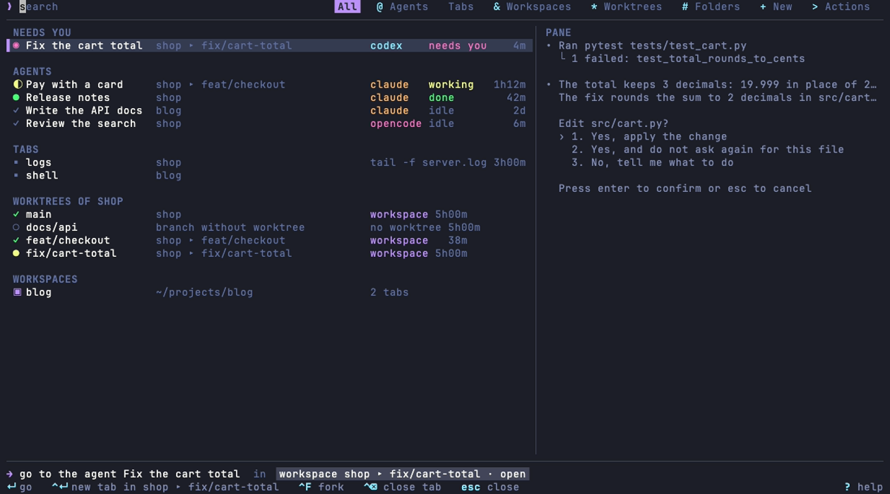
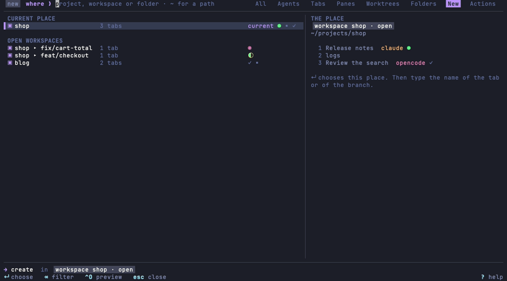
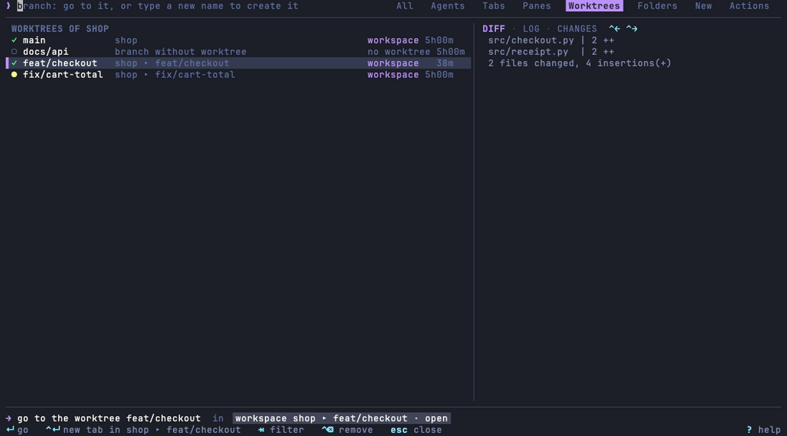

# herdr-omnibar

**One bar to go to an agent, a tab or a workspace of [herdr](https://herdr.dev), and to create a tab, a split or a worktree.**



## Installation

Install a release: give its tag, from the [releases](https://github.com/owpac/herdr-omnibar/releases) page.

```sh
herdr plugin install owpac/herdr-omnibar --ref <tag>
```

The install downloads the release binary for your machine, and checks it with the `SHA256SUMS` file of the release. Without a binary for your machine, the install builds it with cargo (Rust 1.89 or later). Without `--ref`, herdr installs the last commit of `main`. If this commit is not a release commit, the install builds with cargo. Then bind the actions to your keys (see [Actions](#actions)).

## The 2 doors

- **`open`** goes to what exists. The list has the agents that need you first, then the other agents, the tabs without an agent, the worktrees of the current project, the other workspaces and the git projects. `↵` goes to the selected row. If you type a text, the last row is `create “<text>”…`: `↵` on it starts the creation in the current place, with this text as the name. A branch of the current project shows the git state of its worktree: `✓` no change, `●` changes that are not committed, `○` no worktree. Its right column tells if its workspace is open, and the age of its last commit.
- **`new`** creates a tab or a worktree, in 2 steps:
  1. **Where:** the current place first, then the open workspaces, the git projects without a workspace and the other folders. Type `~` or `/` for any folder of the disk: `⇥` completes it.
  2. **What:** type the name. In a git project, `new worktree <name>` comes first: wt creates the branch, its worktree and its own workspace. `new tab` adds a tab to the workspace of the place. In the current workspace, `new split` adds a pane next to the focused pane: to the right of a wide pane, below a tall pane. A name that is not a branch name selects `new tab`.

The typed text is a filter in the step "where", and a name in the step "what". It is never both. A worktree always gets its own workspace, under its project: `herdr-worktrunk ▸ fix-login`.

After `↵`, the popup closes at once. A detached process creates the tab, the workspace or the worktree, then starts the agent. If the creation fails, a herdr notification gives the error.






The filter Worktrees has a group for each project with an open workspace. The current project comes first, with all its branches, and a new worktree if the text is a new branch name. The other projects show only their worktrees, in the order of their workspaces. `↵` goes to the workspace of a worktree, or opens the worktree in its own project.

## Actions

Each filter has its own action. Bind a key to the action of your choice in `~/.config/herdr/config.toml`:

| Action | Opens the popup on |
|--------|--------------------|
| `herdr-omnibar.open` | All: agents, tabs, workspaces and projects |
| `herdr-omnibar.new` | The creation of a tab or a worktree |
| `herdr-omnibar.agents` | The agents |
| `herdr-omnibar.tabs` | The tabs without an agent |
| `herdr-omnibar.workspaces` | The open workspaces |
| `herdr-omnibar.worktrees` | The worktrees of the projects with an open workspace, all the branches of the current project, and a new worktree |
| `herdr-omnibar.folders` | The projects and the folders |
| `herdr-omnibar.actions` | The actions of the herdr plugins |
| `herdr-omnibar.panes` | Each pane of each tab |
| `herdr-omnibar.sort` | Not a popup: it sorts the workspaces of the herdr sidebar |
| `herdr-omnibar.keys` | A tool that shows the keys that the popup receives |

```toml
[[keys.command]]
key = "prefix+p"
type = "plugin_action"
command = "herdr-omnibar.open"

[[keys.command]]
key = "prefix+t"
type = "plugin_action"
command = "herdr-omnibar.new"
```

## Keys

| Key | Result |
|-----|--------|
| `↵` | Go to the selected row, choose a place, create, or run an action. |
| `⇥`, `⇧⇥` | The next or the previous filter. In the step "what": the next agent (claude, codex, opencode, shell). In a path: complete the folder. |
| `@`, `&`, `*`, `#`, `+`, `>`, `%` | On an empty text, from any filter: the agents, the workspaces, the worktrees, the folders, the creation, the actions, the panes. Only the filters of `filters` have a shortcut. The key of the current filter goes back to All. |
| `⌃A` | On a row of `open` that opens a worktree: the next agent. |
| `⌃F` | Fork the session of the selected agent (Claude Code or Codex) into a new tab, with the plugin herdr-fork. The popup closes, the agent gets the focus, then herdr-fork runs its action `tab`. |
| `⌃↵` | A new tab, with its agent, in the open workspace of the selected row: an agent, a tab, a workspace or a worktree. |
| `⌃⌫` | Close the tab of the selected row (the pane only, on a row of the filter Panes), or remove the worktree of the selected branch, after a question on the action line. The main checkout stays. See [Remove a worktree](#remove-a-worktree). |
| `⌃R` | Rename the tab of the selected row. `↵` saves, `esc` keeps the old name. |
| `⌃Y` | In the step "what": start the agent without its permission prompts, for this tab only. |
| `⌃←`, `⌃→` | The view of the preview of a worktree: diff, log, changes. |
| `⌃O` | Show or hide the preview. |
| `⌃U`, `⌃W` | Clear the text, or delete its last word. |
| `esc` | Close the popup, or go back to the step "where". |
| `?`, `F1` | The help. |

The mouse works too: a click selects a row, a double click runs it, and the wheel moves the selection. A click on a chip opens its filter, and a click on a key of the footer runs this key.

The omnibar remembers the last agent of each folder, in `agents.json` of its state folder.

## Remove a worktree

`⌃⌫` on a branch with a worktree asks a question on the action line. The question gives the number of agents of the worktree: in its workspace, or in its folder. After `↵`, the popup closes, then a detached process removes the worktree. A herdr notification gives the result.

The omnibar does not ask the question in 2 cases. The action line then tells why:

- An agent of the worktree works, or waits for an answer.
- The worktree has an idle agent, and herdr-worktrunk 2026.11.33 or later is not installed. Only herdr-worktrunk closes the agents.

- If herdr-worktrunk is installed, its command `remove --path <worktree> --close-agents` removes the worktree. It records the removal for its action `restore`, closes the idle agents, then closes the workspace. An agent that works, or changes that are not committed, stop the removal.
- Else, `wt remove` removes the worktree, and the omnibar closes its workspace. No record exists for a restore.

## Automatic titles of the tabs

A tab with one agent takes the title that the agent gives to its terminal: Claude Code and Codex write their task there. The omnibar renames only a tab with the name that herdr gives (its number), or with the last title that the omnibar wrote. A name that you give stays: after `⌃R` or `herdr tab rename`, the tab keeps your name until it closes. A tab with 2 agents keeps its name. A title that tells nothing (a prompt, the kind of the agent such as `claude`, `codex` or `opencode`, the name of the folder) does not replace a name. The name of a herdr agent (`herdr agent start <name>`) is a title: it replaces the number of the tab, and a later task title of the agent replaces it. When the agent stops, the tab keeps its last title.

One watcher runs for each herdr server. herdr starts it at its start and when it detects an agent. Each opening of the popup starts it again, if it stopped. The watcher reads the snapshot every 2 s. It stops when herdr stops, when you remove `auto_titles` from `features`, or when you disable the plugin. It runs its binary again after a rebuild or an update of the plugin.

herdr-bar also writes the titles of the tabs. While herdr-bar is enabled, and its `config.json` does not set `"auto_titles": false`, the omnibar waits: 2 writers on the same tab fight. To give the titles to the omnibar, write this file:

```sh
echo '{"auto_titles": false}' > ~/.config/herdr/plugins/config/herdr-bar/config.json
```

`herdr-omnibar titles` prints what the watcher does now: the tabs to rename, or the reason to wait. The log of the watcher is `watch.log`, in the state folder of the plugin (`~/.local/state/herdr/plugins/herdr-omnibar/`).

## Configuration

`config.toml` in the config folder of the plugin (`~/.config/herdr/plugins/config/herdr-omnibar/`):

```toml
size = "default"   # "default": 74 % × 62 % of the window, like the other popups. "big": 90 % × 80 %.
roots = ["~/Workspace", "~/projects", "~/src", "~/code", "~/dev", "~/repos"]   # the git projects, 2 levels deep
preview = "full"   # "full": the 3 views of a worktree. "summary": one view.
# The ends of the pills (the current filter, the crumb, the places of the action line).
# "square": half blocks, square corners. "round": half circles of a Nerd Font. "flat": a space.
pills = "square"
# The optional features. Remove a name to turn its feature off.
features = ["mouse", "rename_tab", "auto_titles", "agent_logos", "recent_first"]
# The filters of the chips, in the order of ⇥. Remove a name to hide its filter.
filters = ["all", "agents", "tabs", "workspaces", "worktrees", "folders", "new", "actions"]
# The order of the workspaces in the herdr sidebar (see below).
sidebar_order = ["git", "other"]
```

`filters` gives the chips of the search line, in the order of `⇥` and `⇧⇥`. A filter outside the list has no chip and no shortcut, but its action still opens it: its chip then shows until `⇥` leaves it. The filter `panes` is off by default: it has one row for each pane of each tab. `%` opens it on an empty text. `↵` goes to the tab of the pane, and to the pane of an agent.

`recent_first` sorts the agents, the tabs, the panes and the workspaces by their last use: the tab of the popup goes after the others, so the first row is the tab before, like alt-tab (`⌘P` then `↵`). The group "Needs you" stays first. The watcher writes the time of each change of the focused tab in `recent.json`, in the state folder.

`auto_sort` is off by default, because it changes the order of the sidebar. The watcher then sorts the workspaces with `sidebar_order`, at its start and each time the set of the workspaces changes: a workspace opens or closes. A move of your own (a drag in the sidebar) stays until the next change of the set. If the order is already right, the watcher makes no call to herdr. It writes each sort in `watch.log`. The watcher needs the socket of herdr: it works when herdr starts it.

`agent_logos` shows the logo of each agent before its name, if the font Herdr Agent Icons Max of [herdr-radar](https://github.com/hhdebb/herdr-radar) is installed, like herdr-bar. The omnibar never installs a font. On macOS:

```sh
curl -fsSL -o ~/Library/Fonts/HerdrAgentIconsMax-Regular.ttf \
  https://raw.githubusercontent.com/hhdebb/herdr-radar/main/dist/HerdrAgentIconsMax-Regular.ttf
```

2 features are off by default. Add their names to `features` to turn them on:

- `pull_requests`: the pull request of each branch row. A branch row shows the number of its pull request in the color of its state (open, draft, merged, closed), and the glyph of its checks (✓ passed, ✗ failed, ◐ running). The preview of a worktree gets a 4th view, PR: its title, its state, its size, its checks, its review, its merge state and its last update. One `gh pr list` for each project reads the last 50 pull requests in the background: the network takes 1 to 2 s. gh must be installed and logged in.
- `running_time`: the running time of each agent and of each command, at the right of its row: `47s`, `12m`, `2h04m`, `3d`. A thread reads it in the background, one time for each pane: `herdr pane process-info`, then `ps`. The times show some time after the popup opens.

zoxide adds its folders to the projects and the folders, when it is installed.

## Colors

The omnibar takes the colors of the herdr theme. herdr gives no color to its plugins: the omnibar reads `[theme]` and `[ui] accent` in the config of herdr (`HERDR_CONFIG_PATH`, else `~/.config/herdr/config.toml`). It builds the palette with the rules of herdr: the theme `name`, `dark_name` and `light_name` with `auto_switch`, `[theme.custom]`, then `[theme.custom.dark]` or `[theme.custom.light]`. With the theme `terminal`, the omnibar uses the ANSI colors of the terminal, and fixed greys for the secondary text, the rules and the selected row. The popup reads the config at each opening: after a change of theme, the next opening has the new colors.

With `auto_switch`, herdr asks the terminal for its appearance (dark or light), but the omnibar asks macOS. If the appearance of the terminal differs from the appearance of macOS, the omnibar can use the other theme of the pair. On Linux, the omnibar takes the dark theme. A key with a wrong type in the config of herdr stays without effect.

## The keyboard

The omnibar asks the terminal for the keyboard protocol of kitty. herdr then forwards the modifiers of Enter, Backspace and the arrows to the popup, if your terminal sends them to herdr. The action `herdr-omnibar.keys` shows each key that the popup receives: use it to check `ctrl+Enter`, `ctrl+Backspace` and `ctrl+Left`.

## Development

```sh
mise install                                        # Rust and shellcheck of mise.toml
HERDR_OMNIBAR_BUILD=source sh scripts/install.sh    # build bin/herdr-omnibar with cargo
herdr plugin link "$PWD"
```

`herdr plugin link` does not run the build step: run `scripts/install.sh` again after each change. The checks:

```sh
cargo fmt --check
cargo clippy --locked --all-targets -- -D warnings
cargo test --locked
shellcheck scripts/*.sh
```

`docs/make-images` makes the images of this README with VHS (`brew install vhs`): a demo folder with 2 git projects, a herdr snapshot of example and the screens of its panes. With `OMNIBAR_DEMO=<folder>`, the omnibar reads them, and asks nothing to herdr.

`herdr-omnibar sort` sorts the workspaces of the herdr sidebar, with one call of the socket of herdr (`workspace.move_block`): it works inside herdr, where `HERDR_SOCKET_PATH` is set. The git workspaces come first, grouped by repository and sorted by the name of the repository. In a group, the main workspace comes first, then the linked worktrees sorted by label. The workspaces without git come last, sorted by label. The Actions filter shows it as "Omnibar: sort the workspaces". The key `sidebar_order` of `config.toml` changes this order. It is a list of entries, and each entry takes the workspaces that no earlier entry took:

- `"git"` takes the git workspaces, and `"other"` takes the workspaces without git. The default is `["git", "other"]`.
- An entry with a `/` is a folder (`~` is the home folder). It takes the git projects with a repository root in this folder, at any depth. If 2 folders match a project, the first entry wins.
- Any other entry is the exact label of a herdr workspace. `"~"` is the workspace with the label `~`, not the home folder. If the label is the label of a linked worktree, the full group goes there.

A git workspace always moves with its group: the main workspace and the linked worktrees of the same repository. In each entry, the order is the default order. The workspaces that no entry takes go at the end, in the default order. An entry that takes nothing does nothing. For example:

```toml
sidebar_order = ["~", "~/Workspace/owpac", "~/Workspace/keplair", "git", "other"]
```

`herdr-omnibar sort --print` prints the old and the new order, and changes nothing.

`herdr-omnibar list` prints the workspaces, the agents and the tabs, as the popup sees them. `herdr-omnibar titles` prints the renames of the watcher of the titles.

## Release

Each push to `main` updates the pull request "chore: release YYYY.M.N": it writes the version and the section of `CHANGELOG.md` (git-cliff). The workflow release-merge merges it each day at 19:00 UTC, if all the checks pass: convert it to a draft to stop it. After the merge, the workflow release tags the commit, builds the binaries for Linux and macOS (x86_64 and aarch64), and publishes the release with their `SHA256SUMS`. A GitHub App opens and merges the pull request: its events start the checks, like the events of a person.

## License

[MIT](LICENSE)
